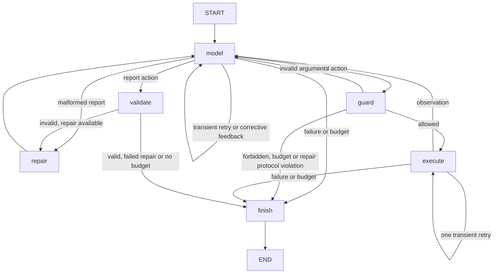

# Incident Triage Agent — CSE 510 checkpoint

A single agent investigates registered synthetic incidents on the fixed `checkout-v1`
topology and returns a cited **draft for human review**. It queries actual fixture logs,
metrics and versioned runbooks through a bounded LangGraph workflow. Four supported
families are connection-pool exhaustion, disk exhaustion, dependency failure and
deployment regression; insufficient or out-of-scope evidence should produce an
inconclusive report. This is a course simulation, with no production-readiness claim.

## Clean-checkout setup

Use **Python 3.13** (verified for this checkpoint), with network access to PyPI for
installation. Package metadata permits Python 3.11+, but other versions have not
been verified for this checkpoint. Run these commands from this repository's root:

```bash
python3.13 -m venv .venv
source .venv/bin/activate
python -m pip install -r requirements.txt -e '.[dev]'
python scripts/generate_fixtures.py --check
python -m pytest -q
```

On Windows, activate with `.venv\Scripts\Activate.ps1` in PowerShell. The application
uses the checked-out fixture/runbook directories, so use the editable install above;
a standalone wheel without this repository's data is not a supported distribution.
Direct dependencies are pinned in `requirements.txt`.

## Offline demonstration (no credentials or network)

```bash
python -m triage investigate INC-001 --question "What caused the 503 errors?" --mode offline-scripted
```

Expected output includes `Mode: offline-scripted`, the FakeLLM warning,
`Terminal status: draft_ready`, `DRAFT — requires human review; unapproved`,
`diagnosed: connection_pool_exhaustion`, cited log/metric/runbook IDs,
`Attempts: model=5/6, tools=4/7`, and a `Trace: .../logs/<run-id>.jsonl` path.
The trace labels the mode and model as `FakeLLM (incident-specific scripts)`.

**FakeLLM has incident-specific scripted answers. These demos and tests establish
workflow behavior, tool execution and guard enforcement; they do not establish
real-model diagnostic accuracy.** Both execution modes use `triage.graph.investigate`
and the same production graph, guardrails, tools, evidence ledger and validator.
The application never imports `tests/`.

Inconclusive, blocked-action and budget demonstrations:

```bash
python -m triage investigate INC-005 --question "What caused the restart?" --mode offline-scripted
python -m triage investigate INC-001 --question "Test the export boundary" --mode offline-scripted --scenario request_export
python -m triage investigate INC-001 --question "Test the budget" --mode offline-scripted --scenario always_tool_call
```

The first returns an inconclusive draft with family `none` and exit code 0. The
second ends `halted` before any tool dispatch, exits 1, and has no report. The third
ends `budget_exceeded`, exits 1, and returns a validated partial with family `none`.
`--scenario follow_injection` with `INC-002` tests a scripted model following injected
log instructions: its export request is blocked and the run halts. That is **blocked
unsafe behavior**, not successful model resistance. Separate integration coverage
tests a stub ignoring the injected instructions and continuing the investigation.

## Real-provider investigation

Use the course-configured OpenAI-compatible gateway and model. The application does
not choose or substitute a provider. Configuration comes from environment variables
or the repository-root `.env`; existing environment variables take precedence.

```bash
cp .env.example .env
# Edit .env locally: set LLM_BASE_URL, LLM_API_KEY and LLM_MODEL to your gateway values.
# LLM_TIMEOUT_S defaults to 60. LLM_JSON_MODE=1 is optional, only if supported by the gateway.
python -m triage investigate INC-001 --question "What caused the 503 errors?" --mode real-provider
```

`.env.example` contains placeholders only; `.env` and local env variants are ignored.
Never commit credentials. `python -m triage llm-check` is an optional connectivity
check; the investigation command above is the end-to-end smoke test. Real-provider
responses can use the budget without diagnosing an incident. A successful diagnostic
claim requires report validation, and every returned report remains unapproved.

No gateway credentials were available during checkpoint verification. The real
provider adapter was exercised through the production workflow with a stubbed client;
**a live-model investigation has not been verified**. Missing configuration returns
`config_error`, exit 2, and a trace with zero model/tool attempts.

Optional `--start` and `--end` accept ISO-8601 timestamps with time zones, defaulting
independently to the registered incident window. The requested window must be ordered
and inside the incident window. Tools must also stay inside the requested window;
metric queries require whole minutes. Example:

```bash
python -m triage investigate INC-001 --question "Investigate this interval" --start 2026-10-06T14:10:00Z --end 2026-10-06T14:40:00Z --mode real-provider
```

Exit codes: **0** = validated diagnosed or inconclusive draft ready for human review;
**1** = halted, budget exhausted, validation failed, operational/internal failure or
trace-write failure; **2** = invalid CLI/input or gateway configuration. A partial
report accompanying an operational failure still exits nonzero. Nothing is approved
or exported by these commands.

## Workflow and hard limits

Input validation happens before model construction or dispatch. Prompt helpers build
the conversation from the topology, tool schemas, incident window and operator question.
The compiled workflow is defined in `src/triage/graph.py`:



There is one tool call per model action, deliberately retaining the existing contract.
Tools are `query_logs`, `query_metrics` and `search_runbooks`. Each successful result
is flagged for instruction-like content, wrapped as untrusted data in the conversation,
and registered in this run's evidence ledger. A diagnosed draft must cite actual IDs
covering logs, metrics and a runbook matching its family. Flagged evidence cannot be
cited. Citation checks establish provenance and schema compliance; human review must
still assess whether evidence supports the explanation.

Limits are six model attempts (including transport retries and report repair) and
seven read-tool attempts (including invalid requests, failures and retries). Each
transient model operation or tool operation can retry once, with all attempts counted.
Model transport failures are explicitly typed `TransientLLMError`; tool timeouts and
connection errors are retryable. Configuration/schema/argument errors are not transport
retried. Corrective feedback can prompt a new action within the remaining model budget.
Reports failing schema or evidence validation get at most one repair, using the existing
ledger; repair cannot request more tools. Budget exhaustion assembles and validates a
partial with status `budget_exceeded`, family `none` and confidence 0. Operational
failures after execution starts can return a validated inconclusive partial. Repeated
report validation failure exposes no report and never prints a diagnosed result.

The allowlist is checked before dispatch, including during repair. Forbidden names,
model-requested export and cross-incident requests halt. There is no shell, arbitrary
web access or infrastructure-modification tool. The application runs one agent.

## Inspect tool execution and traces

Each investigation writes one exclusively created, flushed JSONL file to the ignored
repository-root `logs/` directory, including invalid-input and configuration failures.
The CLI prints the exact path. To inspect calls after the demo above:

```bash
python - <<'PY'
import json
from pathlib import Path
path = max(Path("logs").glob("*.jsonl"), key=lambda p: p.stat().st_mtime_ns)
events = [json.loads(line) for line in path.read_text().splitlines()]
print("Trace:", path)
for event in events:
    if event["event"] == "tool":
        print(event["tool"], event["outcome"], event["args"],
              "attempt", event["tool_attempts"], "evidence", event.get("evidence_count"))
print("Terminal:", events[-1]["outcome"])
PY
```

For `INC-001`, this shows two `query_metrics` calls, one `query_logs` and one
`search_runbooks`. Events include run ID, mode, model identifier, outcome, attempt and
remaining-budget counters, UTC timestamp, elapsed/per-operation timing, safe arguments,
bounded results/errors, validation and terminal outcome. Usage and cost are JSON `null`
when unknown; cost is never estimated. Results are clipped for tracing to 10 list items,
60 object keys and 2,000 characters per string; the model and ledger receive the actual
tool result. Model response bodies and raw exception messages are withheld. Configured
credentials and common credential forms are scrubbed from trace values and keys.

## Checkpoint implementation and remaining work

Implemented: five deterministic development bundles, four runbooks, integrity checks,
three tested read tools, strict contracts, prompt construction, GatewayLLM/FakeLLM,
bounded LangGraph, citation validation with repair, CLI and JSONL traces. The full suite
uses injected providers with no network dependency and exercises these production modules.

Deferred: SQLite run/report persistence; approve/edit/reject/expiry workflow; approved
export; held-out evaluation harness and accuracy measurement; fixed-pipeline baseline;
calibration and retention/deletion tooling. `review.py` and `tools/export.py` remain
explicit placeholders, unreachable from the model. No UI, MCP or multiple agents are
part of this checkpoint. Development scripts must not be presented as held-out results.
The proposal in `docs/proposal.md` retains its historical intent; `docs/architecture.md`
distinguishes this checkpoint from the proposed full system.
