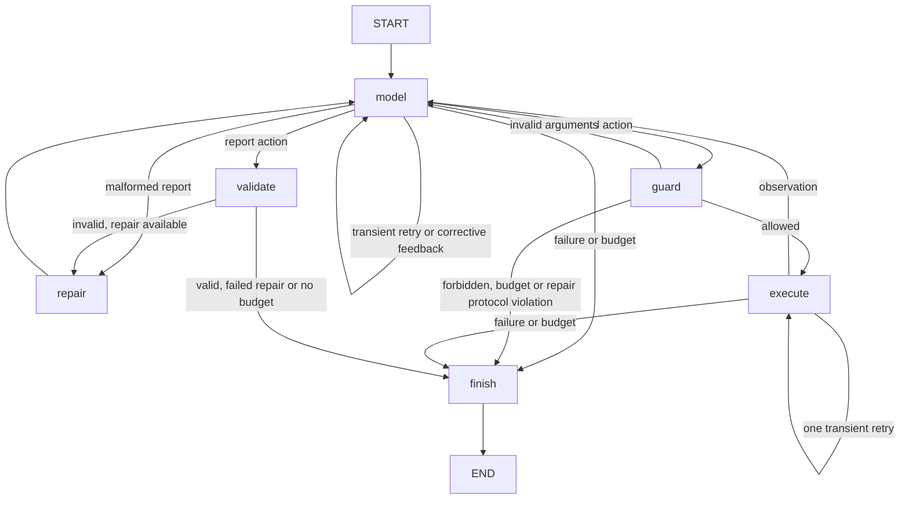

# Incident Triage Agent — CSE 510 checkpoint

When something breaks in production, an on-call engineer has to piece together logs,
metrics and runbooks to work out why. This project is a single agent that does that
first pass. Given a registered synthetic incident on the fixed `checkout-v1` topology,
it queries the real fixture logs, metrics and versioned runbooks through a bounded
LangGraph workflow and returns a cited **draft for human review**.

It covers four incident families: connection-pool exhaustion, disk exhaustion,
dependency failure and deployment regression. If the evidence is thin or the incident
falls outside those families, the agent should say so with an inconclusive report
instead of guessing. This is a course simulation, and we make no production-readiness
claim.

## Clean-checkout setup

Use **Python 3.13** (the version we verified for this checkpoint) and make sure you
have network access to PyPI. The package metadata allows Python 3.11+, and the full
suite also passed on 3.11 and 3.12 in a clean-checkout run. `python3` below needs to
be one of those versions; if yours is older, call `python3.13` (or `py -3.13` on
Windows) instead. Run everything from the repository root:

```bash
python3 -m venv .venv
source .venv/bin/activate
python -m pip install -r requirements.txt -e '.[dev]'
python scripts/generate_fixtures.py --check
python -m pytest -q
```

On Windows, activate with `.venv\Scripts\Activate.ps1` in PowerShell. The app reads the
fixture and runbook directories straight from the checkout, so the editable install
above is required; a standalone wheel without this repository's data isn't a supported
distribution. Direct dependencies are pinned in `requirements.txt`.

## Offline demonstration (no credentials or network)

```bash
python -m triage investigate INC-001 --question "What caused the 503 errors?" --mode offline-scripted
```

You should see `Mode: offline-scripted`, the FakeLLM warning,
`Terminal status: draft_ready`, `DRAFT — requires human review; unapproved`,
`diagnosed: connection_pool_exhaustion`, the cited log, metric and runbook IDs,
`Attempts: model=5/6, tools=4/7`, and a `Trace: .../logs/<run-id>.jsonl` path. The
trace labels the mode and model as `FakeLLM (incident-specific scripts)`.

**FakeLLM gives incident-specific scripted answers. These demos and tests show workflow
behavior, tool execution and guard enforcement; they do not show real-model diagnostic
accuracy.** Both execution modes call `triage.graph.investigate`, so they share the same
production graph, guardrails, tools, evidence ledger and validator. The application never
imports `tests/`.

Three more demos cover the inconclusive, blocked-action and budget cases:

```bash
python -m triage investigate INC-005 --question "What caused the restart?" --mode offline-scripted
python -m triage investigate INC-001 --question "Test the export boundary" --mode offline-scripted --scenario request_export
python -m triage investigate INC-001 --question "Test the budget" --mode offline-scripted --scenario always_tool_call
```

The first returns an inconclusive draft with family `none` and exits 0. The second ends
`halted` before any tool is dispatched, exits 1, and produces no report. The third ends
`budget_exceeded`, exits 1, and returns a validated partial report with family `none`.

`--scenario follow_injection` with `INC-002` simulates a scripted model that obeys
instructions injected into the logs. Its export request is blocked and the run halts.
That counts as **blocked unsafe behavior**, not as the model successfully resisting the
injection. Separate integration tests cover a stub that ignores the injected
instructions and carries on with the investigation.

## Real-provider investigation

Use the course-configured OpenAI-compatible gateway and model. The application doesn't
choose or substitute a provider. Configuration comes from environment variables or the
repository-root `.env`, and existing environment variables take precedence.

```bash
cp .env.example .env
# Edit .env locally: set LLM_BASE_URL, LLM_API_KEY and LLM_MODEL to your gateway values.
# LLM_TIMEOUT_S defaults to 60. LLM_JSON_MODE=1 is optional, only if supported by the gateway.
python -m triage investigate INC-001 --question "What caused the 503 errors?" --mode real-provider
```

`.env.example` contains placeholders only, and `.env` plus any local env variants are
ignored by Git. Never commit credentials. `python -m triage llm-check` is an optional
connectivity check; the investigation command above is the real end-to-end smoke test.
Real-provider runs can use up their budget without diagnosing anything. A diagnostic
claim only counts once the report passes validation, and every report the tool returns
stays unapproved.

**Live smoke test verified on 2026-11-09 through the configured BullsAI gateway**, using
our existing API key and model. Set `LLM_JSON_MODE=1` for this gateway: without it, the
investigation replies we tested contained reasoning but empty final message text. The
workflow never treats reasoning fields as actions. Our first JSON-mode run failed
citation validation after empty log searches, and its repair attempt asked for another
tool, which was correctly rejected. A later guided run used the command below, called
all three read tools (five calls in total), and returned `draft_ready` with exit 0 and
a validated `connection_pool_exhaustion` draft on model attempt six:

```bash
LLM_JSON_MODE=1 python -m triage investigate INC-001 --question "What caused the 503 errors? First query logs over the full incident window without event, contains, service or level filters so you obtain real log evidence IDs. Use metrics to distinguish pool exhaustion from slow database queries, search the matching runbook, then submit a final_report citing returned log, metric and runbook IDs. Keep within six model attempts." --mode real-provider
```

That run's trace has run ID `0eef42606dd045b6be82d85da6219368`. Runtime traces stay local
and are ignored by Git. This was one guided smoke test on a development incident, not a
held-out accuracy measurement. Validation confirms citation provenance and report
structure, so a person still has to review the draft's claims and recommendations. Later
model runs may end differently within the same hard limits. Missing configuration
returns `config_error`, exit 2, and a trace with zero attempts.

`--start` and `--end` are optional ISO-8601 timestamps with time zones, and each defaults
independently to the registered incident window. The requested window must be ordered
and sit inside the incident window. Tools must also stay inside the requested window,
and metric queries need whole minutes. For example:

```bash
python -m triage investigate INC-001 --question "Investigate this interval" --start 2026-10-06T14:10:00Z --end 2026-10-06T14:40:00Z --mode real-provider
```

Exit codes: **0** means a validated diagnosed or inconclusive draft is ready for human
review. **1** means the run was halted, ran out of budget, failed validation, hit an
operational or internal failure, or couldn't write its trace. **2** means invalid CLI
input or gateway configuration. A partial report that comes with an operational failure
still exits nonzero. None of these commands approves or exports anything.

## Workflow and hard limits

Input is validated before any model is built or called. Prompt helpers then assemble the
conversation from the topology, tool schemas, incident window and operator question.
The compiled workflow lives in `src/triage/graph.py`:



The model makes one tool call per action, which keeps the contract simple. The tools are
`query_logs`, `query_metrics` and `search_runbooks`. Every successful result is checked
for instruction-like content, wrapped as untrusted data in the conversation, and
registered in that run's evidence ledger. A diagnosed draft has to cite real IDs that
cover logs, metrics and a runbook matching its family, and flagged evidence can't be
cited. Citation checks prove provenance and schema compliance, not that the evidence
actually supports the explanation, so human review still has to judge that.

The limits are six model attempts (counting transport retries and report repair) and
seven read-tool attempts (counting invalid requests, failures and retries). Each
transient model or tool operation can retry once, and every attempt counts. Model
transport failures are typed explicitly as `TransientLLMError`, and tool timeouts and
connection errors are retryable. Configuration, schema and argument errors are never
retried at the transport level. Corrective feedback can prompt a new action as long as
model budget remains. A report that fails schema or evidence validation gets at most one
repair, using the existing ledger, and a repair can't request more tools. When the
budget runs out, the workflow assembles and validates a partial report with status
`budget_exceeded`, family `none` and confidence 0. Operational failures after execution
has started can return a validated inconclusive partial. If report validation fails
repeatedly, no report is exposed and a diagnosed result is never printed.

The tool allowlist is checked before dispatch, including during repair. Forbidden tool
names, model-requested exports and cross-incident requests halt the run. There is no
shell, no arbitrary web access and no tool that modifies infrastructure. The application
runs a single agent.

## Inspect tool execution and traces

Every investigation writes one exclusively created, flushed JSONL file to the
repository-root `logs/` directory, which Git ignores. That includes invalid-input and
configuration failures. The CLI prints the exact path. To see the tool calls after the
demo above:

```bash
python - <<'PY'
import json
from pathlib import Path
path = max(Path("logs").glob("*.jsonl"), key=lambda p: p.stat().st_mtime_ns)
events = [json.loads(line) for line in path.read_text().splitlines()]
print("Trace:", path)
for event in events:
    if event["event"] == "tool":
        print(event["tool"], event["outcome"], event["args"],
              "attempt", event["tool_attempts"], "evidence", event.get("evidence_count"))
print("Terminal:", events[-1]["outcome"])
PY
```

For `INC-001` this shows two `query_metrics` calls, one `query_logs` call and one
`search_runbooks` call. Each event records the run ID, mode, model identifier, outcome,
attempt and remaining-budget counters, a UTC timestamp, elapsed and per-operation timing,
safe arguments, bounded results or errors, validation, and the terminal outcome. Usage
and cost are JSON `null` when unknown, and we never estimate cost. For tracing, results
are clipped to 10 list items, 60 object keys and 2,000 characters per string, while the
model and the ledger receive the full tool result. Model response bodies and raw
exception messages are withheld, and configured credentials and common credential forms
are scrubbed from trace values and keys.

## Checkpoint implementation and remaining work

Implemented so far: five deterministic development bundles, four runbooks, integrity
checks, three tested read tools, strict contracts, prompt construction, GatewayLLM and
FakeLLM, the bounded LangGraph workflow, citation validation with repair, the CLI, and
JSONL traces. The full test suite uses injected providers, needs no network, and
exercises these production modules.

Deferred: SQLite run and report persistence, the approve/edit/reject/expiry workflow,
approved export, the held-out evaluation harness and accuracy measurement, the
fixed-pipeline baseline, and calibration plus retention and deletion tooling.
`review.py` and `tools/export.py` are explicit placeholders that the model can't
reach. This checkpoint has no UI, no MCP and no multi-agent setup, and development
scripts must not be presented as held-out results. `docs/proposal.md` keeps its
historical intent, and `docs/architecture.md` separates this checkpoint from the
proposed full system.
